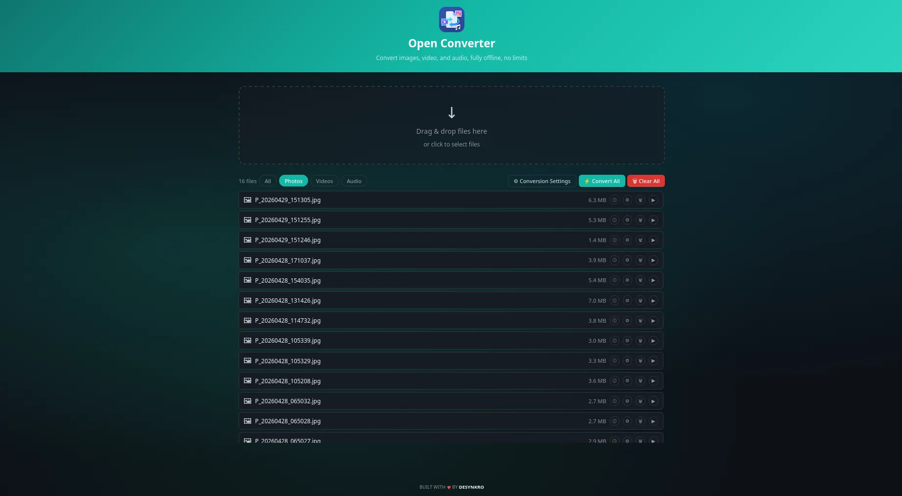
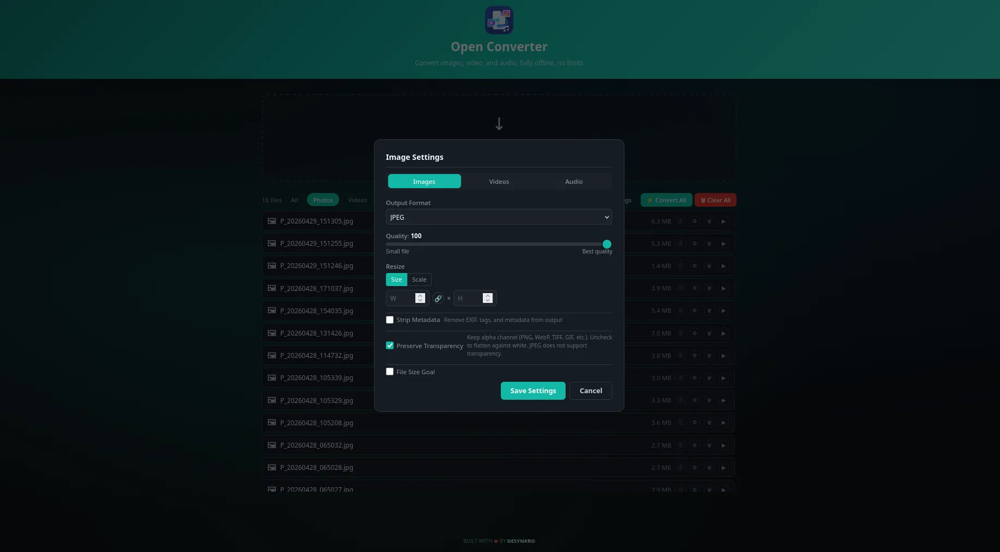
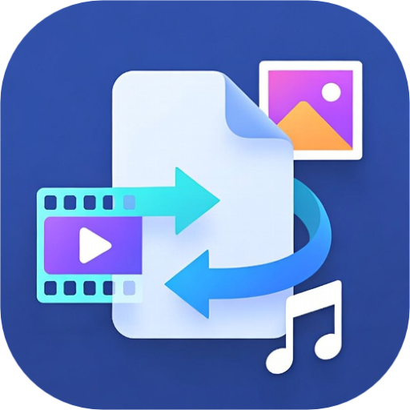

# Open Converter

[](https://codeberg.org/DeSynkro/open-converter)

A self-hosted, fully offline media converter with a dark WebUI. Runs entirely in Docker with no host dependencies.

Built by [DeSynkro](https://desynkro.com) with assistance from [Opencode](https://opencode.ai).

Made with love for the community, and a special thank you to everyone who was welcoming and kind, it means a lot.

## Requirements

- [Docker](https://docs.docker.com/engine/install/) with the Compose plugin

## Quick Start

### First time

```bash
git clone https://codeberg.org/DeSynkro/open-converter.git
cd open-converter
docker compose up --build -d
```

Open [http://localhost:9002](http://localhost:9002)

### Update to latest version

```bash
git pull
docker compose up --build -d
```

> **Alpha notice.** This is an early alpha release. Only image conversion is available. Video and audio conversion are locked and will be added in a future release. Breaking changes to settings storage and configuration may occur between versions.

## Screenshots

[](app/static/screenshots/dashboard.webp)
[](app/static/screenshots/settings.webp)

## Why this exists

There are plenty of hosted media converters, but they all send your files to a remote server. That means your photos, videos, and audio recordings pass through someone else's hands, on someone else's network, subject to someone else's terms.

This project flips that. You run it on your own machine, your own network, your own terms. No signup, no API keys, no upload limits, no file size caps. Just Docker and a folder you can back up with one command.

## Features

- **Self-hosted and private** — runs on your hardware, zero cloud dependencies
- **Zero telemetry** — no analytics, no tracking, no phone-home, no CDN
- **Fully offline** — the only network request leaving your LAN is the initial `docker pull` for the base image
- **Your files, your rules** — uploads and outputs stored as plain files on disk, fully portable, backup by copying one folder
- **Drag-and-drop upload** — files enter only through the WebUI, auto-categorized into Images, Videos, and Audio
- **Per-file overrides** — override conversion settings for individual files without affecting the group defaults
- **Aspect ratio lock** — toggle lock to preserve original aspect ratio during resize, or unlock for exact dimensions
- **File size goal** — target a specific output file size (JPEG only in alpha)
- **Preserve transparency** — keep alpha channel for PNG, WebP, TIFF, GIF; flatten against white when unchecked
- **Strip metadata** — remove EXIF, tags, and other metadata from output files
- **Dark WebUI** — teal/cyan theme built with FastAPI, Jinja2, and HTMX (no JavaScript framework)
- **Sequential processing** — one file at a time to prevent memory exhaustion
- One `docker compose up --build -d` and done

## What data is stored

| Kept | Not kept |
|---|---|
| Uploaded files (in `data/uploads/`) | No analytics |
| Converted output files (in `data/converted/`) | No telemetry of any kind |
| Settings and per-file overrides (JSON) | No logs sent anywhere |
| Upload and conversion timestamps | No user accounts, emails, or IPs |

HTMX, fonts, and all assets are served directly from the app itself. No CDN, analytics, or third-party servers are contacted on page load. The only network request leaving your network is the initial `docker pull` during setup.

## Tech Stack

| Layer | How |
|---|---|
| Backend | Python 3.12 + FastAPI |
| Frontend | HTMX + Jinja2 (no JavaScript framework) |
| Styling | CSS with dark teal/cyan theme |
| Image conversion | ImageMagick |
| Audio conversion | ffmpeg (locked in alpha) |
| Video conversion | ffmpeg (locked in alpha) |
| Container | Docker / Docker Compose (single container) |
| Persistence | Plain files on disk + JSON |

## Project structure

```text
├── docker-compose.yml      Single service, port 9002
├── Dockerfile              python:3.12-slim + ffmpeg + imagemagick
├── requirements.txt        Python dependencies
├── .gitignore              Git rules
├── LICENSE                 GPL v3
├── CHANGELOG.md            Release history
├── README.md               This file
├── app/
│   ├── __init__.py
│   ├── main.py             FastAPI routes and HTMX handlers
│   ├── models.py           Pydantic schemas
│   ├── storage.py          JSON persistence for files, settings, overrides
│   ├── metadata.py         File metadata extraction
│   ├── converters/
│   │   ├── __init__.py     Shared conversion state and dispatch
│   │   ├── image.py        ImageMagick-based image converter
│   │   └── audio.py        ffmpeg-based audio converter (locked)
│   ├── templates/
│   │   └── index.html      Single-page WebUI
│   └── static/
│       ├── style.css       Dark theme styles
│       ├── htmx.min.js     HTMX (self-hosted)
│       ├── favicon.ico     App favicon
│       ├── logo.png        App logo
│       └── screenshots/    Dashboard and settings previews
└── data/                  Auto-created at startup (gitignored)
    ├── files.json
    ├── settings.json
    ├── overrides.json
    ├── uploads/
    └── converted/
```

## Troubleshooting

### Port conflict

The dashboard listens on port 9002. To change it, edit the `ports:` line in `docker-compose.yml`:

```yaml
ports:
  - "9002:9002"    # change left side to your preferred port
```

### Permission errors

The container runs as root inside the container. If you see permission errors on `./data/`, ensure the directory exists:

```bash
mkdir -p data
```

## License

GNU General Public License v3.0 or later. See [LICENSE](LICENSE).

## Credits

- Built by [DeSynkro](https://desynkro.com)
- Assisted by [Opencode](https://opencode.ai)
- Thank you to the self-hosted community for being welcoming

[](https://desynkro.com)
